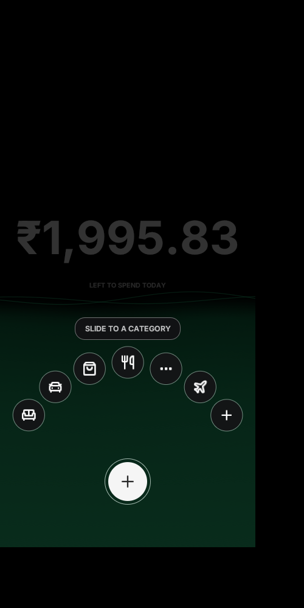
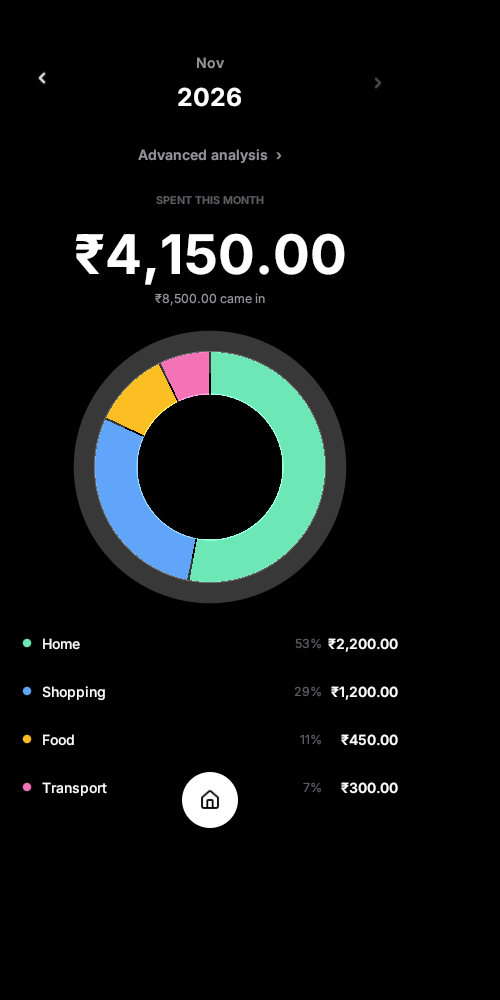
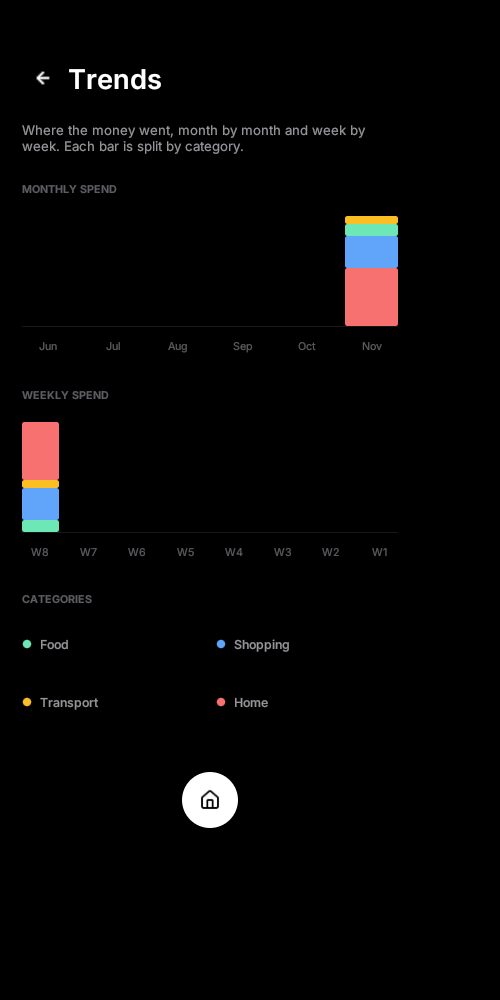
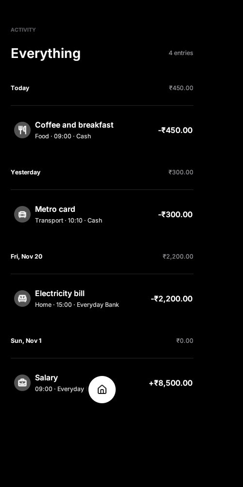
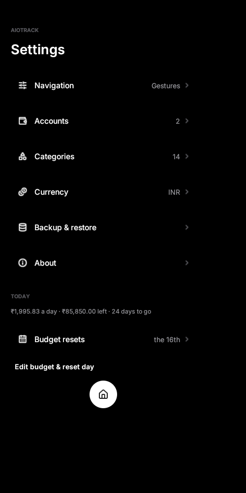

# AioTrack

A quiet, private daily expense tracker for Android — written entirely in Rust.
No Java or Kotlin app code, no cloud, no account, no permissions. One JSON file
on your phone holds everything.

AioTrack turns your monthly budget into a single number: **what you can spend
today**. A soft wave behind it rises as you spend, shifting from green to red.

## Screenshots

| Today | Hold to add |
| :---: | :---: |
|  |  |

| Analysis | Advanced trends |
| :---: | :---: |
|  |  |

| Activity | Settings |
| :---: | :---: |
|  |  |

## Download

Get the newest signed APK from the
[latest release](https://github.com/MananSukhani/AioTrack/releases/latest).
Both builds are attached there:

- **`AioTrack.apk`** — release build, signed with the stable key (installs over
  previous versions).
- **`AioTrack-debug.apk`** — debug build for trying changes quickly.

Requires Android 8.0 or newer. Since this is a private, sideloaded app you may
need to allow installation from your browser or file manager. Every push to
`main` refreshes the release, so the link above always points at the newest
build and updates install in place without losing data.

## Features

- **One number, no clutter** — Home shows only the money available to spend
  today, in huge white type on true black AMOLED.
- **Budget that thinks** — set a monthly budget and the day it resets. Your
  allowance is your opening balance for the day divided by the days left in
  that cycle, minus what you have already spent today, so it updates with every
  entry. If you pass that allowance, the number turns negative (with a `-`) and
  the label reports what you spent today.
- **Living wave** — a continuously drifting wash rises with today's spending:
  green → yellow → orange → red, full when today's allowance is gone.
- **Hold to add** — press and hold the white **+**. Your most-used categories
  arc around your thumb; slide to highlight (with haptics) and release to
  choose. New categories appear here immediately, and **New** creates one.
- **System keyboard** — amounts open the Android number pad, names open the
  normal keyboard. There is no in-app keypad.
- **Optional details** — name, date, time and account default to sensible
  values and can be changed before saving.
- **Analysis & trends** — a monthly donut, plus advanced monthly and weekly
  stacked-bar charts split by category. Both animate in smoothly.
- **Gestures or buttons** — swipe up from Home for Activity, right for Analysis
  and left for Settings. Swipe down from Activity, or right from the other
  pages, to return Home. Prefer taps? Switch on the button bar in Settings.
- **Dynamic categories and accounts** — create, rename and delete your own
  categories; manage cash, bank, card and savings accounts with balances.
- **Ten currencies** — USD, EUR, GBP, INR, JPY, CAD, AUD, CHF, SGD and AED, with
  correct grouping (including Indian lakh format) and JPY without decimals.
- **Backup & restore** — local JSON backups, plus an exportable state file in
  the app's private storage. Nothing is uploaded anywhere.
- **Onboarding & haptics** — a short first-run flow teaches the gestures, and
  haptic feedback confirms the important interactions.

Money is stored as integer minor units, so amounts never drift through
floating-point arithmetic.

## Gestures

| From Home | Opens |
| :--- | :--- |
| Swipe up | Activity |
| Swipe right | Analysis |
| Swipe left | Settings |
| Hold the **+** | Category picker |

From Activity, Analysis or Settings, swipe toward Home to go back (down from
Activity, right from the others). The system Back key also unwinds one screen
at a time.

## Privacy

AioTrack requests **no permissions** and contains no analytics, ads or network
calls. All state lives in one JSON file inside the app's private storage. The
release signing key is kept in GitHub Actions secrets, not in this repository,
so it stays private while still giving every release the same identity.

## Credits

- Interface typography: **Inter** (SIL Open Font License 1.1).
- Icons: **Lucide** (ISC licence), embedded as crisp alpha masks.
- Launcher artwork: custom cat-and-piggy-bank illustration.
- Made by **Manan Sukhani**.

## Support

If AioTrack is useful to you, you can support its development:

[GitHub profile](https://github.com/MananSukhani) ·
[Project repository](https://github.com/MananSukhani/AioTrack) ·
[Download APK](https://github.com/MananSukhani/AioTrack/releases/latest/download/AioTrack.apk)

## Builds

Release and debug APKs are built, signed and published automatically by GitHub
Actions from `main`. There is no local Android SDK setup to maintain; the
workflow in `.github/workflows/android.yml` is the single source of truth for
build configuration and release assets.

Signing needs two repository secrets: `ANDROID_KEYSTORE_BASE64` and
`ANDROID_KEYSTORE_PASSWORD`. See `android/keystore/README.md`.

## Licence

MIT. See `Cargo.toml` for package details.
